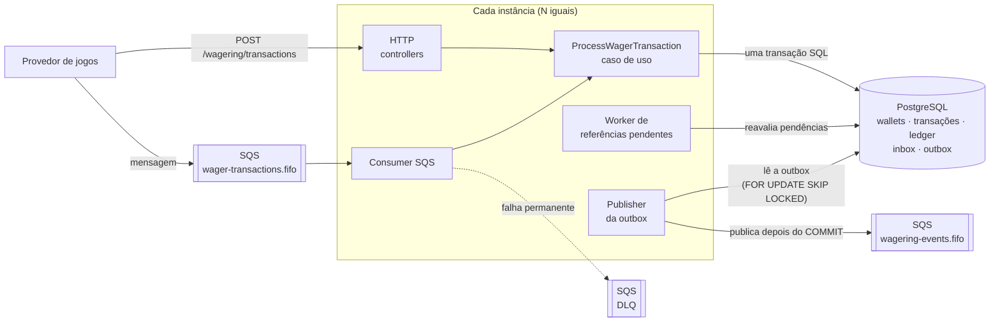
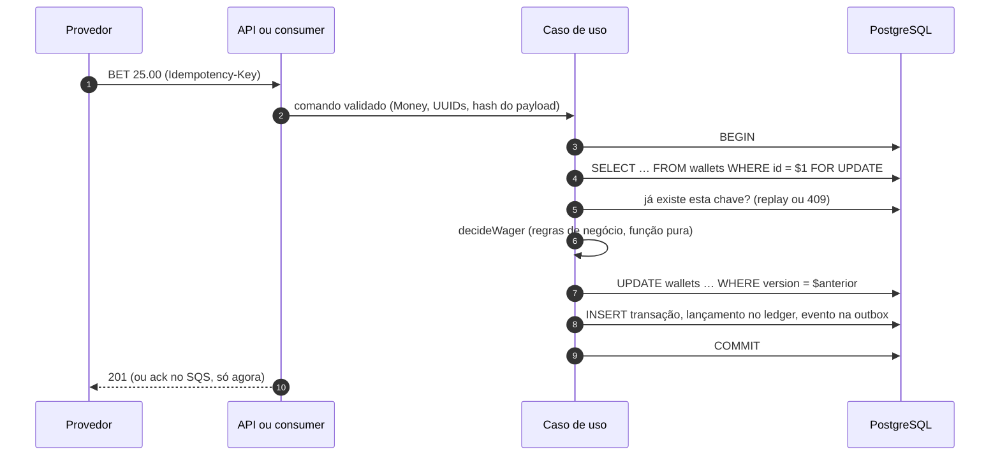

# Distributed Wagering Processor

Serviço financeiro que processa transações de apostas (`BET`, `WIN`, `LOSS`, `REFUND`, `ROLLBACK`)
vindas de provedores de jogos por **HTTP** e por **SQS**, rodando em **várias instâncias** ao mesmo
tempo. Cada jogador tem uma wallet com saldo exato e um ledger imutável que explica cada centavo.

Stack: Bun 1.x, TypeScript (strict), NestJS, MikroORM, PostgreSQL 17, SQS (LocalStack), pino.
Decisões completas, taxonomia de erros e limitações estão no [`ARCHITECTURE.md`](ARCHITECTURE.md);
este README é o mapa e o guia de uso.

## Destaques

- **Correção provada, não prometida.** 295 testes unitários, 184 de integração, 6 de concorrência e
  1 com **três processos reais** (`SIGKILL`, `SIGTERM` e reinício), todos com PostgreSQL e SQS
  reais, sem mocks de banco ou fila.
- **O banco é a última linha de defesa.** Saldo não negativo, ledger append-only (trigger),
  cadeia de lançamentos sem buracos, uma reversão por referência e idempotência são `CHECK`,
  `UNIQUE` e triggers, não só código.
- **Concorrência por wallet.** Lock `FOR UPDATE` por wallet, com `version` como segunda defesa;
  wallets diferentes nunca se bloqueiam.
- **Mensageria sem perda e sem duplicata.** Inbox, saldo, ledger e outbox na mesma transação; `ack`
  só depois do `COMMIT`; retry com backoff, DLQ explícita e ordem preservada por wallet.
- **Reconciliação.** `POST /wallets/:walletId/reconciliation` confere o saldo gravado contra o
  ledger, e o teste de carga termina reconciliando todas as wallets criadas.
- **Teste de carga honesto.** `bun run test:load` contra as três instâncias: cerca de 290 req/s
  em uma máquina de desenvolvimento, sem erro 5xx, 200 de 200 wallets consistentes, com o gargalo
  (o publisher da outbox) nomeado e medido ([ARCHITECTURE.md, seção 16](ARCHITECTURE.md)).
- **Autenticação OIDC opcional.** O `AuthGuard` valida um bearer token do Keycloak (JWKS,
  `iss`/`aud`/`exp`), exige escopos (`wagers:submit`, `wagers:read`, `wallets:manage`) e confere o
  `providerId` do token contra o corpo; fica desligada por padrão (`AUTH_ENABLED=false`) para a
  demonstração — ver [ARCHITECTURE.md, seção 14](ARCHITECTURE.md).
- **Simples de propósito.** Sem gateway, painéis ou tracing distribuído: o que ficou de fora e por
  quê está em [ARCHITECTURE.md, seção 17](ARCHITECTURE.md).

## Início rápido

Com Docker e [Bun](https://bun.sh) instalados:

```bash
bun install
docker compose --profile app up -d --build --wait   # Postgres, LocalStack, migrations e 3 instâncias (localhost:3001 a 3003)
DEMO_BASE_URL=http://localhost:3001 bun run demo    # roteiro narrado: aposta, replay, conflito, pendência, SQS, reconciliação
docker compose rm -sf migrate app-1 app-2 app-3     # desliga as instâncias; Postgres e LocalStack seguem no ar
```

Se a porta 5432 do host já estiver em uso, veja o [Setup](#setup).

**Neste documento:** [Visão geral](#visão-geral) · [Arquitetura](#arquitetura) ·
[Como uma aposta é processada](#como-uma-aposta-é-processada) ·
[Garantias e como são impostas](#garantias-e-como-são-impostas) · [Mensageria](#mensageria) ·
[Várias instâncias](#várias-instâncias) · [Estrutura do código](#estrutura-do-código) ·
[Pré-requisitos e setup](#pré-requisitos) · [Comandos](#comandos) · [Endpoints](#endpoints) ·
[Testes que provam o enunciado](#cenários-obrigatórios-de-concorrência--teste)

## Visão geral

O que o serviço garante, e que o resto do documento mostra como:
- **Saldo exato.** Dinheiro nunca é `number`: o código usa o value object `Money` (decimal), o banco
  usa `NUMERIC(20,2)` e os contratos trafegam strings (`"25.00"`).
- **Uma aposta, um efeito.** Reenviar a mesma requisição (HTTP ou SQS, na mesma ou em outra
  instância) nunca debita duas vezes: a idempotência é garantida por `UNIQUE` no banco.
- **Sem corrida no saldo.** Cada wallet tem o seu lock no Postgres; wallets diferentes andam em
  paralelo.
- **Nada some e nada se duplica.** Saldo, ledger, inbox e outbox são gravados na mesma transação SQL;
  o evento só sai para a fila depois do `COMMIT`, e a mensagem de entrada só recebe `ack` depois dele.
- **Auditável.** O ledger é append-only (trigger no banco) e um endpoint de reconciliação confere o
  saldo gravado contra a soma do ledger.
- **Sem estado na memória.** Qualquer instância pode morrer a qualquer momento; as outras continuam
  sem coordenação extra.

## Arquitetura



HTTP e SQS são apenas dois transportes para o **mesmo caso de uso**. Tudo o que importa para a
correção está no Postgres; a fila de entrada e a de eventos são o SQS.

### Camadas

```
src/
  domain/          regras de negócio puras: Money, Wallet, WagerTransaction, ledger, erros
  application/     casos de uso e portas (repositórios, TransactionRunner, Clock, IdGenerator)
  infrastructure/  adaptadores: MikroORM, SQS, workers, métricas, logs, configuração
  interfaces/      entrada: controllers HTTP, consumer SQS, filtro de erros, DTOs
```

- **A dependência aponta sempre para dentro** (`interfaces` → `application` → `domain`). O domínio
  não importa framework, ORM nem outras camadas; `bun run check:architecture` falha o build se
  isso mudar.
- Entidades de domínio têm construtor privado, fábricas estáticas e estado encapsulado. As entidades
  do ORM são classes separadas (`EntitySchema`); o repositório converte entre as duas.
- Erros de domínio têm um `failureCode` estável (por exemplo `INSUFFICIENT_FUNDS`); a camada
  `interfaces` traduz para status HTTP. Detalhes: [`ARCHITECTURE.md`, seções 2 a 5](ARCHITECTURE.md).

## Como uma aposta é processada



| Passo                                      | Por que assim                                                               | Se falhar aí                                                                                       |
| ------------------------------------------ | --------------------------------------------------------------------------- | -------------------------------------------------------------------------------------------------- |
| Valida antes de abrir a transação          | entrada inválida nunca ocupa conexão nem lock                               | `400`, nada gravado                                                                                |
| `SELECT … FOR UPDATE` na wallet            | só uma transação por wallet decide sobre o saldo, em qualquer instância     | espera até 2 s; depois a falha é transitória e o caso de uso é refeito (até 3 vezes)               |
| Idempotência consultada **depois** do lock | duplicatas concorrentes esperam na fila e encontram a original já commitada | replay devolve o resultado original; payload diferente dá `409`                                    |
| `UPDATE … WHERE version = $anterior`       | segunda defesa: se o lock faltasse, nenhuma linha mudaria                   | a transação falha e é desfeita                                                                     |
| Tudo na mesma transação                    | saldo, ledger, transação e outbox existem juntos ou não existem             | crash antes do `COMMIT`: nada foi gravado e o reenvio processa normalmente                         |
| Resposta ou `ack` só depois do `COMMIT`    | o provedor nunca é avisado de algo que não foi gravado                      | crash depois do `COMMIT` e antes do `ack`: a mensagem volta, vira replay e não gera segundo efeito |

Regras por tipo de transação, referência e interpretações adotadas:
[`ARCHITECTURE.md`, seções 6 e 8](ARCHITECTURE.md).

## Garantias e como são impostas

O banco é a última linha de defesa: as invariantes valem mesmo se o código errar.

| Garantia                                       | Mecanismo                                                                                                        | Onde se prova                                                                          |
| ---------------------------------------------- | ---------------------------------------------------------------------------------------------------------------- | -------------------------------------------------------------------------------------- |
| Saldo exato                                    | `Money` decimal, `NUMERIC(20,2)`, strings no JSON; `bun run check:money` proíbe `parseFloat`, `Number()` e afins | `test/unit/domain/money.test.ts`                                                       |
| Saldo nunca negativo                           | `CHECK (balance >= 0)` na wallet, além da regra de domínio                                                       | `test/integration/schema.test.ts`                                                      |
| Ledger append-only                             | trigger `ledger_append_only` bloqueia `UPDATE` e `DELETE`                                                        | `test/integration/schema.test.ts`                                                      |
| Ledger coerente                                | `CHECK` aritmético do lançamento e `UNIQUE (wallet_id, wallet_version)` formam uma cadeia sem buracos            | `test/integration/invariants.test.ts`                                                  |
| Resultado da transação imutável                | trigger `wager_transactions_guard`: identidade e valores nunca mudam depois de gravados                          | `test/integration/schema.test.ts`                                                      |
| Idempotência                                   | `UNIQUE (provider_id, idempotency_key)` e `UNIQUE (provider_id, external_transaction_id)`                        | `test/concurrency/wagering-races.test.ts`                                              |
| Uma reversão por referência                    | índice único parcial `wager_tx_single_reversal_uq`                                                               | `test/integration/schema.test.ts`                                                      |
| Sem corrida no saldo                           | lock `FOR UPDATE` por wallet + `UPDATE … WHERE version`                                                          | `test/concurrency/wagering-races.test.ts`                                              |
| Evento nunca antes do `COMMIT`                 | evento gravado na tabela `outbox_messages` na mesma transação; um publisher o envia depois                       | `test/integration/process-wager.test.ts` e `test/integration/outbox-publisher.test.ts` |
| Mensagem nunca perdida nem aplicada duas vezes | inbox com `UNIQUE (consumer_name, message_id)` na mesma transação; `ack` depois do `COMMIT`                      | `test/integration/sqs-consumer.test.ts`                                                |
| Saldo confere com o ledger                     | reconciliação sob demanda: `POST /wallets/:walletId/reconciliation`                                              | `test/integration/reconciliation.test.ts`                                              |

A tabela completa, enunciado → teste, está em
[Cenários obrigatórios](#cenários-obrigatórios-de-concorrência--teste) e
[Testes obrigatórios](#testes-obrigatórios--teste-que-prova).

## Mensageria

O consumer lê `wager-transactions.fifo` e chama o mesmo caso de uso do HTTP. O `MessageGroupId` é a
wallet, então a ordem por wallet se mantém entre laços e entre instâncias. As filas de transações e
de eventos usam FIFO de alta vazão (`FifoThroughputLimit=perMessageQueueId`,
`DeduplicationScope=messageGroup`); a DLQ permanece FIFO padrão.

| O que aconteceu com a mensagem                                                   | O que o consumer faz                                                                              |
| -------------------------------------------------------------------------------- | ------------------------------------------------------------------------------------------------- |
| Resultado gravado (`PROCESSED`, `REJECTED`, `PENDING_REFERENCE`, replay)         | `ack` **depois** do `COMMIT`                                                                      |
| Erro permanente (payload inválido, wallet inexistente, conflito de idempotência) | vai direto para a DLQ, com `failureCode`; reprocessar nunca mudaria o resultado                   |
| Falha transitória (lock, deadlock, conexão)                                      | volta para a fila com backoff exponencial e jitter; depois de 10 entregas o SQS a leva para a DLQ |
| Erro inesperado (bug)                                                            | backoff nas duas primeiras entregas; na terceira, DLQ explícita com `INTERNAL_ERROR`              |
- **Rejeição de negócio não é falha da mensagem.** Saldo insuficiente grava uma transação
  `REJECTED` e a mensagem recebe `ack`.
- **Referência fora de ordem.** Um `REFUND` ou `ROLLBACK` que chega antes da `BET` fica
  `PENDING_REFERENCE` (`202`); um worker o reavalia até a referência chegar ou o limite de
  tentativas acabar (`REJECTED` com `REFERENCE_NOT_FOUND`).
- **Eventos.** A outbox é publicada em `wagering-events.fifo` (grupo = wallet, deduplicação =
  `eventId`). Se o publisher morrer no meio, outro assume o lote depois do lease; o pior caso é
  publicação duplicada, tratada pela deduplicação, nunca perda.

Detalhes e justificativas: [`ARCHITECTURE.md`, seções 11 e 12](ARCHITECTURE.md).

## Várias instâncias

Nenhum estado que importa para a correção fica na memória de um processo. Por isso `N` instâncias
iguais dividem o trabalho sem coordenação:

| Peça                 | O que impede duas instâncias de pisarem uma na outra                             |
| -------------------- | -------------------------------------------------------------------------------- |
| HTTP e consumer      | lock da linha da wallet e `UNIQUE` de idempotência e de inbox                    |
| Consumer             | o SQS FIFO não entrega o mesmo grupo (wallet) a dois receptores ao mesmo tempo   |
| Publisher da outbox  | reserva com `FOR UPDATE SKIP LOCKED` + lease; reenvio deduplicado pelo `eventId` |
| Worker de pendências | a mesma reserva com lease e o lock da wallet na reavaliação                      |

O Compose sobe três instâncias ([como](#três-instâncias-com-docker)), e o teste com três processos
reais, com `SIGKILL`, `SIGTERM` e reinício, prova que nada se perde nem se duplica. O
[teste de carga](#teste-de-carga) exercita as três instâncias juntas e termina reconciliando todas
as wallets.

## Estrutura do código

```
src/
  domain/
    shared/        Money, códigos de falha, erros base
    wallet/        Wallet, lançamento do ledger
    wager/         WagerTransaction, decisão (decideWager), tipos e estados
    events/        eventos de integração
    messaging/     inbox e outbox como conceitos de domínio
  application/
    wager/         processa transação, resolve referência pendente
    wallet/        criação e reconciliação de wallets
    messaging/     publicação da outbox
    ports/         interfaces de repositório, relógio, ids, transação
  infrastructure/
    persistence/   schemas, repositórios, queries e migrations
    sqs/           cliente SQS e publisher de eventos
    workers/       loops do publisher da outbox e das referências pendentes
    metrics/ logging/ config/ auth/ ids/ time/
  interfaces/
    http/          controllers (wagering, wallets, health, metrics) e filtro de erros
    sqs/           consumer, schema da mensagem e política de falha
scripts/           migrate, demo, load, check-money, check-architecture
test/              unit · integration · concurrency · multi-instance
```

## Pré-requisitos

- [Bun](https://bun.sh) 1.x
- Docker com Docker Compose

## Setup

```bash
bun install
cp .env.example .env          # opcional: os defaults já apontam para o docker compose
docker compose up -d --wait   # Postgres (porta 5432 do host) e LocalStack com as filas SQS
bun run migration:up          # aplica as migrations no banco `wagering`
bun run dev                   # API em http://localhost:3000 (recarrega ao salvar)
```

O Postgres é publicado na porta padrão **5432** do host. Se já houver um Postgres local nela,
defina `POSTGRES_HOST_PORT=5433` e `DB_PORT=5433` no `.env` (o Compose e a aplicação leem as duas).
Na primeira subida do volume, o container também cria o banco `wagering_test`,
usado pelos testes de integração. Se o volume já existia antes, crie-o à mão:
`docker compose exec postgres createdb -U wagering wagering_test`.

`bun run migration:up` (e o serviço `migrate` do Compose) também cria o papel `wagering_app` e
aplica os grants: a app roda com esse papel, que só tem DML (`SELECT`, `INSERT`, `UPDATE` e
`DELETE` apenas na outbox, para a retenção) — sem DDL nem `TRUNCATE`. As migrations continuam
rodando como o dono (`DB_USER`, `wagering`). É idempotente e roda mesmo num volume já migrado.

## Três instâncias com Docker

O profile `app` do Compose constrói a imagem da aplicação, aplica as migrations (serviço `migrate`,
que roda uma vez e termina) e sobe três instâncias iguais que compartilham o mesmo Postgres e as mesmas filas:

```bash
docker compose --profile app up -d --build --wait   # app-1, app-2 e app-3 em localhost:3001, 3002 e 3003
curl -s localhost:3001/health/ready                 # idem para 3002 e 3003
docker compose kill -s SIGKILL app-2                # simula a queda de uma instância
docker compose --profile app up -d --wait app-2     # ela volta; as outras seguem processando
docker compose rm -sf migrate app-1 app-2 app-3     # derruba só as instâncias; Postgres e LocalStack seguem no ar
```

Cada instância tem `mem_limit` de 256 MB e `stop_grace_period` de 30 s, tempo suficiente para o
shutdown terminar as mensagens em andamento. O profile não sobe por padrão, para não pesar nos testes.

### Autenticação (opcional)

A autenticação fica desligada por padrão (`AUTH_ENABLED=false`). Para ligar com o Keycloak local:

```bash
docker compose --profile auth up -d --wait   # sobe o Keycloak (localhost:8080) e importa o realm
AUTH_ENABLED=true \
OIDC_ISSUER=http://localhost:8080/realms/wagering \
OIDC_AUDIENCE=wagering-app \
OIDC_JWKS_URI=http://localhost:8080/realms/wagering/protocol/openid-connect/certs \
bun run start
```

Os clients são `provider-a` e `provider-b` (`wagers:submit`, `wagers:read`) e `backoffice`
(`wallets:manage`), todos `client_credentials`. Detalhes em [ARCHITECTURE.md, seção 14](ARCHITECTURE.md).

### Observabilidade (opcional)

O profile `observability` sobe o Prometheus (coleta o `/metrics` das três instâncias e avalia as
regras de alerta) e o Grafana com o dashboard provisionado. Não há Alertmanager: o disparo aparece
no Prometheus e no Grafana.

```bash
docker compose --profile app --profile observability up -d --build --wait
# Grafana:    http://localhost:3000  (admin/admin) → dashboard "Wagering — visão geral"
# Prometheus: http://localhost:9090  (Alerts e Targets)
```

Alertas: instância fora do ar (`up == 0`), lag da outbox acima de 60 s, backlog acima de 5.000,
mensagens novas na DLQ e mais de 10 conflitos de lock em 5 min. O Prometheus guarda 6 h de séries
(256 MB) e o Grafana roda com 384 MB.

## Comandos

| Comando                       | O que faz                                                                                                                                                                                             |
| ----------------------------- | ----------------------------------------------------------------------------------------------------------------------------------------------------------------------------------------------------- |
| `bun run dev`                 | sobe a API com recarga automática                                                                                                                                                                     |
| `bun run start`               | sobe a API                                                                                                                                                                                            |
| `bun run typecheck`           | checagem de tipos (`tsc --noEmit`)                                                                                                                                                                    |
| `bun run lint`                | lint e formatação (Biome)                                                                                                                                                                             |
| `bun run check:money`         | falha se o código usar `parseFloat`, `parseInt`, `Number()` ou `toFixed` fora das exceções listadas no script (dinheiro nunca é `number`)                                                             |
| `bun run check:architecture`  | falha se `src/domain` ou `src/application` importarem framework, ORM, SDK ou as camadas externas (`infrastructure`, `interfaces`); exceções listadas no script                                        |
| `bun run test`                | testes unitários (`test/unit`, sem Docker)                                                                                                                                                            |
| `bun run test:integration`    | testes de integração (`test/integration`, Postgres e LocalStack reais)                                                                                                                                |
| `bun run test:concurrency`    | testes de concorrência (`test/concurrency`, requisições HTTP simultâneas contra Postgres real)                                                                                                        |
| `bun run test:multi-instance` | três processos da aplicação contra o mesmo Postgres e as mesmas filas, com `SIGKILL`, `SIGTERM` e reinício no meio do processamento (`test/multi-instance`); o mais pesado, rode por último e sozinho |
| `bun run test:load`           | teste de carga contra as três instâncias do Compose, com reconciliação de todas as wallets ao final (ver "Teste de carga")                                                                            |
| `bun run demo`                | roteiro narrado contra a API já no ar (ver "Demonstração")                                                                                                                                            |
| `bun run migration:up`        | aplica as migrations pendentes                                                                                                                                                                        |
| `bun run migration:down`      | reverte a última migration                                                                                                                                                                            |

Use `bun run test`, e não `bun test` puro: este último também executaria os testes de integração.

## Demonstração

Com a infraestrutura, as migrations e a API no ar (`docker compose up -d --wait`,
`bun run migration:up`, `bun run start`), em outro terminal:

```bash
bun run demo
```

O roteiro cria uma wallet e percorre, narrando cada passo em português: `BET`, `WIN`, replay
idempotente (mesma resposta, mesmo `transactionId`), conflito de idempotência, saldo insuficiente,
`REFUND` entregue antes da `BET` (fica `PENDING_REFERENCE` e o worker o resolve quando a `BET`
chega), uma `BET` entregue pela fila SQS (este passo pode esperar até 40 s pelo consumer), reconciliação e as linhas `wagering_` de `/metrics`.
Sai com código diferente de zero se algum passo não se comportar como esperado. Variáveis:
`DEMO_BASE_URL` (padrão `http://localhost:3000`) e as mesmas `SQS_*`/`AWS_*` da aplicação.

## Teste de carga

Com as três instâncias no ar (`docker compose up -d --wait postgres localstack`,
`bun run migration:up`, `docker compose --profile app up -d --build --wait`):

```bash
bun run test:load                       # 60 s, 32 usuários virtuais, 200 wallets
LOAD_DURATION_S=20 bun run test:load    # execução curta
bun run test:load --json                # resumo em JSON no stdout (o texto vai para o stderr)
```

O script cria as wallets, gera uma mistura de `BET`, `WIN`, `REFUND`, replays idempotentes e
saldo insuficiente (parte do tráfego concentrada em poucas wallets, para disputar o lock), mede
latência e vazão, soma as métricas das instâncias, espera a outbox esvaziar e reconcilia todas as
wallets. Sai com código diferente de zero se houver `5xx`, resposta inesperada, saldo negativo,
saldo diferente do esperado, reconciliação inconsistente ou outbox que não esvazia. Metodologia,
resultados e análise estão na seção 16 do `ARCHITECTURE.md`. Não grava arquivos.

| Variável               | Padrão                                                              | Efeito                                            |
| ---------------------- | ------------------------------------------------------------------- | ------------------------------------------------- |
| `LOAD_TARGETS`         | `http://localhost:3001,http://localhost:3002,http://localhost:3003` | instâncias alvo, em rodízio                       |
| `LOAD_DURATION_S`      | `60`                                                                | duração do tráfego                                |
| `LOAD_CONCURRENCY`     | `32`                                                                | usuários virtuais simultâneos                     |
| `LOAD_WALLETS`         | `200`                                                               | wallets criadas                                   |
| `LOAD_HOT_WALLETS`     | `5`                                                                 | wallets "quentes" (as primeiras)                  |
| `LOAD_HOT_RATIO`       | `0.3`                                                               | fração das novas `BET` enviada às wallets quentes |
| `LOAD_DRAIN_TIMEOUT_S` | `180`                                                               | prazo para a outbox esvaziar                      |

O gerador roda na mesma máquina do sistema testado e disputa CPU com ele: os números servem para
comparar execuções nesta máquina, não como capacidade.

## CI

O GitHub Actions (`.github/workflows/ci.yml`) roda em todo pull request e em todo push para
`develop` e `main`: typecheck, lint, `check:money`, `check:architecture`, testes unitários e, com o Postgres e o
LocalStack do `docker-compose.yml`, os testes de integração, os de concorrência e, por último, o de
múltiplas instâncias.

## Testes de integração

Precisam do `docker compose up -d --wait` em execução: usam o Postgres e o LocalStack reais (sem
mocks), no banco `wagering_test`, e aplicam as migrations sozinhos. Cada teste limpa as tabelas
antes de rodar. Os logs da aplicação ficam silenciosos durante os testes, mesmo com `LOG_LEVEL` no `.env`; para
vê-los, defina `TEST_LOG_LEVEL` (ex.: `TEST_LOG_LEVEL=info bun run test:integration`).

## Variáveis de ambiente

| Variável                             | Padrão                        | Descrição                                                                                                                                |
| ------------------------------------ | ----------------------------- | ---------------------------------------------------------------------------------------------------------------------------------------- |
| `PORT`                               | `3000`                        | porta HTTP da API                                                                                                                        |
| `LOG_LEVEL`                          | `info`                        | nível de log do pino (`silent` desliga)                                                                                                  |
| `DB_HOST`                            | `localhost`                   | host do Postgres                                                                                                                         |
| `DB_PORT`                            | `5432`                        | porta do Postgres                                                                                                                        |
| `DB_USER`                            | `wagering`                    | usuário do Postgres (dono: roda as migrations; no compose a app usa `wagering_app`)                                                      |
| `DB_PASSWORD`                        | `wagering`                    | senha do Postgres                                                                                                                        |
| `DB_NAME`                            | `wagering`                    | banco da aplicação                                                                                                                       |
| `DB_APP_USER`                        | `wagering_app`                | papel DML-only da app, criado pelo passo de grants após as migrations                                                                    |
| `DB_APP_PASSWORD`                    | `wagering_app`                | senha do papel DML-only da app                                                                                                           |
| `TEST_DB_NAME`                       | `wagering_test`               | banco usado pelos testes de integração                                                                                                   |
| `TEST_LOG_LEVEL`                     | `silent`                      | nível de log da aplicação nos testes de integração                                                                                       |
| `SQS_ENDPOINT`                       | `http://localhost:4566`       | endpoint do SQS (LocalStack)                                                                                                             |
| `SQS_TRANSACTIONS_QUEUE`             | `wager-transactions.fifo`     | nome da fila de entrada de transações                                                                                                    |
| `SQS_TRANSACTIONS_DLQ`               | `wager-transactions-dlq.fifo` | nome da DLQ da fila de entrada                                                                                                           |
| `SQS_EVENTS_QUEUE`                   | `wagering-events.fifo`        | nome da fila de eventos publicados pela outbox                                                                                           |
| `AWS_REGION`                         | `us-east-1`                   | região AWS                                                                                                                               |
| `AWS_ACCESS_KEY_ID`                  | `test`                        | credencial AWS (LocalStack aceita qualquer valor)                                                                                        |
| `AWS_SECRET_ACCESS_KEY`              | `test`                        | credencial AWS                                                                                                                           |
| `OUTBOX_PUBLISHER_ENABLED`           | `true`                        | liga o publisher da outbox nesta instância (`false` desliga; nos testes de integração o padrão é `false`)                                |
| `OUTBOX_POLL_INTERVAL_MS`            | `250`                         | intervalo entre ciclos do publisher quando não há lote cheio                                                                             |
| `OUTBOX_BATCH_SIZE`                  | `50`                          | máximo de eventos reservados por ciclo                                                                                                   |
| `OUTBOX_LEASE_MS`                    | `30000`                       | prazo da reserva de um lote; se a instância morrer, outra o assume depois disso                                                          |
| `OUTBOX_PUBLISH_CONCURRENCY`         | `5`                           | máximo de chamadas `SendMessageBatch` simultâneas num ciclo do publisher                                                                 |
| `OUTBOX_RETENTION_ENABLED`           | `true`                        | liga o worker que apaga eventos publicados antigos (`false` desliga; nos testes de integração o padrão é `false`)                        |
| `OUTBOX_RETENTION_POLL_INTERVAL_MS`  | `60000`                       | intervalo entre ciclos do worker de retenção                                                                                             |
| `OUTBOX_RETENTION_MAX_AGE_MS`        | `604800000` (7 dias)          | eventos publicados há mais tempo que isto são apagados                                                                                   |
| `OUTBOX_RETENTION_BATCH_SIZE`        | `1000`                        | máximo de eventos apagados por ciclo                                                                                                     |
| `SQS_CONSUMER_ENABLED`               | `true`                        | liga o consumer da fila de transações nesta instância (`false` desliga; nos testes de integração o padrão é `false`)                     |
| `SQS_CONSUMER_LOOPS`                 | `2`                           | laços de recebimento independentes por instância                                                                                         |
| `SQS_RECEIVE_BATCH_SIZE`             | `4`                           | máximo de mensagens por recebimento (até 10); laços × lote = transações ao mesmo tempo, abaixo do pool de 10 conexões                    |
| `SQS_WAIT_TIME_SECONDS`              | `10`                          | duração do long polling do consumer (até 20)                                                                                             |
| `SHUTDOWN_TIMEOUT_MS`                | `20000`                       | prazo para as mensagens em andamento terminarem no desligamento; precisa ser ≥ `SQS_WAIT_TIME_SECONDS` × 1000 + 5000                     |
| `PENDING_REFERENCE_WORKER_ENABLED`   | `true`                        | liga o worker que reavalia transações `PENDING_REFERENCE` nesta instância (`false` desliga; nos testes de integração o padrão é `false`) |
| `PENDING_REFERENCE_POLL_INTERVAL_MS` | `1000`                        | intervalo entre ciclos do worker quando não há lote cheio                                                                                |
| `PENDING_REFERENCE_LEASE_MS`         | `30000`                       | prazo da reserva de um lote de pendências; se a instância morrer, outra o assume depois disso                                            |
| `REFERENCE_RETRY_BASE_MS`            | `2000`                        | primeira espera por uma referência que ainda não chegou; dobra a cada tentativa                                                          |
| `REFERENCE_RETRY_MAX_MS`             | `60000`                       | teto da espera entre tentativas (≥ `REFERENCE_RETRY_BASE_MS`)                                                                            |
| `REFERENCE_MAX_ATTEMPTS`             | `10`                          | avaliações da referência antes de rejeitar (`REFERENCE_NOT_FOUND` ou `REFERENCE_NOT_PROCESSED`)                                          |
| `AUTH_ENABLED`                       | `false`                       | exige bearer token nas rotas protegidas; `true` obriga `OIDC_ISSUER`, `OIDC_AUDIENCE` e `OIDC_JWKS_URI`                                  |
| `OIDC_ISSUER`                        | (vazio)                       | `iss` esperado no token (ex.: `http://localhost:8080/realms/wagering`)                                                                   |
| `OIDC_AUDIENCE`                      | (vazio)                       | `aud` esperado — o público da API (ex.: `wagering-app`)                                                                                  |
| `OIDC_JWKS_URI`                      | (vazio)                       | JWKS do IdP para validar a assinatura do token                                                                                           |

## Endpoints

| Método e rota                                                             | Descrição                                                                                                                                                                                                                                                                                                           |
| ------------------------------------------------------------------------- | ------------------------------------------------------------------------------------------------------------------------------------------------------------------------------------------------------------------------------------------------------------------------------------------------------------------- |
| `POST /wallets`                                                           | cria uma wallet: `{ "playerId": "<uuid>", "initialBalance": { "amount": "1000.00", "currency": "BRL" } }` → `201`                                                                                                                                                                                                   |
| `GET /wallets/:walletId`                                                  | consulta a wallet → `200 { id, playerId, balance, version }`                                                                                                                                                                                                                                                        |
| `GET /wallets/:walletId/ledger?cursor=&limit=`                            | ledger em ordem de versão, paginado (`limit` de 1 a 200, padrão 50) → `200 { items, nextCursor }`                                                                                                                                                                                                                   |
| `POST /wallets/:walletId/reconciliation`                                  | confere o saldo gravado contra o ledger → `200` sempre que a wallet existe (divergência vem no corpo: `consistent: false` e `issues`), `404 WALLET_NOT_FOUND`. Só lê: nunca corrige nada                                                                                                                            |
| `POST /wagering/transactions`                                             | submete `BET`, `WIN`, `LOSS`, `REFUND` ou `ROLLBACK` (header `Idempotency-Key` obrigatório) → `201` processada, `202` aguardando a referência, `422` rejeitada por regra de negócio (ex.: `INSUFFICIENT_FUNDS`, `REVERSAL_INSUFFICIENT_FUNDS`, `BALANCE_LIMIT_EXCEEDED`), `409` chave reutilizada com outro payload |
| `GET /wagering/transactions/:transactionId`                               | consulta uma transação pelo id interno → `200`, `404 NOT_FOUND`                                                                                                                                                                                                                                                     |
| `GET /providers/:providerId/wagering/transactions/:externalTransactionId` | consulta uma transação pelo id do provedor → `200`, `404 NOT_FOUND`                                                                                                                                                                                                                                                 |
| `GET /health/live`                                                        | processo vivo                                                                                                                                                                                                                                                                                                       |
| `GET /health/ready`                                                       | Postgres e filas SQS alcançáveis (`503` se alguma dependência cair)                                                                                                                                                                                                                                                 |
| `GET /metrics`                                                            | métricas Prometheus desta instância (texto), sem autenticação; o Prometheus coleta cada instância e agrega                                                                                                                                                                                                          |

Exemplo:

```bash
curl -s -XPOST localhost:3000/wallets -H 'content-type: application/json' \
  -d '{"playerId":"0192f28f-5dc0-7d58-bdb2-814ad6a0f4a1","initialBalance":{"amount":"1000.00","currency":"BRL"}}'
```

Aposta de `25.00` (troque `<walletId>` pelo `id` devolvido acima; o `playerId` precisa ser o dono
da wallet):

```bash
curl -s -XPOST localhost:3000/wagering/transactions -H 'content-type: application/json' \
  -H 'idempotency-key: provider-a:bet-1' \
  -d '{"providerId":"provider-a","externalTransactionId":"bet-1","playerId":"0192f28f-5dc0-7d58-bdb2-814ad6a0f4a1","walletId":"<walletId>","roundId":"round-1","gameId":"game-1","kind":"BET","money":{"amount":"25.00","currency":"BRL"}}'
# → 201 {"transactionId":"...","status":"PROCESSED","balance":{"amount":"975.00","currency":"BRL"},"idempotentReplay":false}
```

Reenviar a mesma requisição devolve o mesmo resultado com `"idempotentReplay": true` e o header
`Idempotent-Replayed: true`, sem novo débito. Reenviar a mesma chave com outro valor devolve
`409 IDEMPOTENCY_CONFLICT`. `REFUND` e `ROLLBACK` exigem `referenceExternalTransactionId`.

Erros seguem sempre o formato `{ "error": { "code", "message", "retryable" } }`; o mapeamento de
códigos para status HTTP está em `ARCHITECTURE.md`.

## Cenários obrigatórios de concorrência → teste

Testes em `test/concurrency/wagering-races.test.ts` (`bun run test:concurrency`). Para rodar um só,
filtre pelo nome: `bun run test:concurrency -t "2×80.00"`.

| #   | Cenário                                                                          | Teste                                                                                                                                                                                                                                                                                                                             |
| --- | -------------------------------------------------------------------------------- | --------------------------------------------------------------------------------------------------------------------------------------------------------------------------------------------------------------------------------------------------------------------------------------------------------------------------------- |
| 1   | a mesma aposta enviada 50 vezes em paralelo → um único débito                    | `same BET 50× in parallel (same key and payload) → all 201, 49 replays, one row, one DEBIT, balance 75.00`; complementado por `same key on 2 different wallets in parallel → one 201, the other 409 IDEMPOTENCY_CONFLICT, no 5xx`                                                                                                 |
| 2   | operações concorrentes disputando o saldo da mesma wallet (100.00 com 2 × 80.00) | `100.00 with 2×80.00 at the same time, 10 rounds → one 201, one 422 INSUFFICIENT_FUNDS, balance 20.00, one DEBIT`; complementado por `REFUND and ROLLBACK of the same BET in parallel → one 201, one 422 ALREADY_REVERSED, a single CREDIT back`                                                                                  |
| 3   | wallets distintas processadas em paralelo                                        | `10 wallets × 20 BETs of 7.00 at the same time → per wallet 14 processed, 6 INSUFFICIENT_FUNDS, balance 2.00`; complementado por `lock is per wallet: a BET on wallet B gets 201 in < 1 s while wallet A stays locked`                                                                                                            |
| 4   | ≥ 3 processos/instâncias simultâneos                                             | `three instances with SIGKILL, SIGTERM and restart › the final state is the script's: nothing lost, nothing duplicated` (em `test/multi-instance/multi-instance.test.ts`, `bun run test:multi-instance`)                                                                                                                          |
| 5   | worker morto depois do commit e antes do ack                                     | `an instance that dies after COMMIT and before the ack: another one acks it without a second effect` (em `test/integration/sqs-consumer.test.ts`); complementado pelo `SIGKILL` no meio do processamento do teste com três instâncias                                                                                             |
| 6   | dois publishers sobre a mesma outbox                                             | `two concurrent publishers over 100 events -> every event received, none claimed twice, none left pending` (em `test/integration/outbox-publisher.test.ts`, `bun run test:integration`); complementado por `lease: a claimed batch that is never published is not re-claimed before the lease expires, and is published after it` |
| 7   | `ROLLBACK` ou `REFUND` entregue antes da referência                              | `REFUND before its BET → the BET wakes it and the REFUND is PROCESSED with its events` e `chain: WIN(BET) and ROLLBACK(WIN) before the BET → both PROCESSED, in order` (em `test/integration/pending-reference.test.ts`); também no roteiro do teste com três instâncias                                                          |
| 8   | reinício do serviço com comprovação da consistência final                        | o teste com três instâncias: reinicia as instâncias derrubadas por `SIGKILL` e `SIGTERM` e confere ledger, saldos, inbox, DLQ e eventos publicados                                                                                                                                                                                |

## Testes obrigatórios → teste que prova

Complementa a tabela anterior com a seção "Testes obrigatórios" do enunciado (unidade e integração).
Os caminhos são relativos a `test/`.

| Exigência                                                                             | Arquivo                                                                   | Teste                                                                                                                                                                                                                                                                                                                            |
| ------------------------------------------------------------------------------------- | ------------------------------------------------------------------------- | -------------------------------------------------------------------------------------------------------------------------------------------------------------------------------------------------------------------------------------------------------------------------------------------------------------------------------- |
| `Money`: escala, arredondamento e entradas inválidas                                  | `unit/domain/money.test.ts`                                               | `never rounds silently: 3 decimals is rejected, not rounded`; `exact decimal arithmetic`; `normalizes to 2 decimals`; `rejects %p with InvalidMoneyError`                                                                                                                                                                        |
| `Money`: soma fora da faixa do `NUMERIC(20,2)` é erro de domínio                      | `unit/domain/money.test.ts`                                               | `add beyond the NUMERIC(20,2) range throws InvalidMoneyError instead of a database error`                                                                                                                                                                                                                                        |
| Crédito acima do limite do saldo é rejeição de negócio (`422 BALANCE_LIMIT_EXCEEDED`) | `unit/domain/wager-decision.test.ts`, `integration/process-wager.test.ts` | `WIN that would exceed the balance limit -> REJECTED BALANCE_LIMIT_EXCEEDED`; `REFUND whose credit would overflow NUMERIC(20,2) → REJECTED BALANCE_LIMIT_EXCEEDED`                                                                                                                                                               |
| Invariantes da `Wallet`                                                               | `unit/domain/wallet.test.ts`                                              | `debit more than balance (WAGER) throws InsufficientFundsError; balance and version unchanged`; `sequence open 100, debit 30, credit 50 → 120.00, version 3, sum of entries equals balance`                                                                                                                                      |
| Regras de `BET`                                                                       | `unit/domain/wager-decision.test.ts`                                      | `decideWager BET › debits the wallet and processes`; `insufficient funds rejects and leaves the wallet intact`                                                                                                                                                                                                                   |
| Regras de `WIN`                                                                       | `unit/domain/wager-decision.test.ts`                                      | `decideWager WIN › without reference credits the wallet`; `with reference to a PROCESSED BET of the same round links it`                                                                                                                                                                                                         |
| Regras de `LOSS`                                                                      | `unit/domain/wager-decision.test.ts`                                      | `decideWager LOSS › processes with no ledger entry and leaves the wallet intact`                                                                                                                                                                                                                                                 |
| Regras de `REFUND`                                                                    | `unit/domain/wager-decision.test.ts`                                      | `decideWager REFUND › credits the referenced BET amount`; `already reversed -> ALREADY_REVERSED`                                                                                                                                                                                                                                 |
| Regras de `ROLLBACK`                                                                  | `unit/domain/wager-decision.test.ts`                                      | `decideWager ROLLBACK › of a BET credits the wallet`; `of a WIN debits the wallet`                                                                                                                                                                                                                                               |
| Conflito de moeda                                                                     | `unit/domain/wallet.test.ts`                                              | `credit/debit in another currency throws CurrencyMismatchError`                                                                                                                                                                                                                                                                  |
| Conflito de moeda na aposta                                                           | `unit/domain/wager-decision.test.ts`                                      | `decideWager BET › currency different from the wallet -> CURRENCY_MISMATCH`                                                                                                                                                                                                                                                      |
| Idempotency key com payload divergente                                                | `integration/process-wager.test.ts`                                       | `same key with a different amount → IdempotencyConflictError; nothing written`                                                                                                                                                                                                                                                   |
| Hash do payload (base do conflito)                                                    | `unit/application/payload-hash.test.ts`                                   | `different payload -> different hash (amount 25.00 vs 25.01)`                                                                                                                                                                                                                                                                    |
| Migrations e constraints                                                              | `integration/schema.test.ts`                                              | `migration up/down/up is reversible`; `balance -0.01 → wallets_balance_non_negative_ck`; `second PROCESSED reversal of the same reference → wager_tx_single_reversal_uq`; `PROCESSED REFUND/ROLLBACK without reference_transaction_id → wager_tx_reversal_resolved_ck`; `UPDATE and DELETE → trigger error` (ledger append-only) |
| Atomicidade entre wallet, ledger, inbox e outbox                                      | `integration/process-wager.test.ts`                                       | `when the outbox insert fails, no tx/ledger/outbox row remains and the balance is intact`; `when the outbox insert fails, no inbox row remains`; `command with a receipt writes the inbox row together with transaction, ledger and outbox`                                                                                      |
| Inbox e redelivery                                                                    | `integration/sqs-consumer.test.ts`                                        | `a redelivered message (same messageId) debits once and both deliveries are acked`; `the same messageId with a different payload goes to the DLQ as IDEMPOTENCY_CONFLICT`                                                                                                                                                        |
| Publishers concorrentes sobre a mesma outbox                                          | `integration/outbox-publisher.test.ts`                                    | `two concurrent publishers over 100 events -> every event received, none claimed twice, none left pending`                                                                                                                                                                                                                       |
| Retry                                                                                 | `integration/sqs-consumer.test.ts`                                        | `a transient failure that clears up is processed on a later delivery, without the DLQ`                                                                                                                                                                                                                                           |
| DLQ                                                                                   | `integration/sqs-consumer.test.ts`                                        | `an unexpected error goes to the DLQ as INTERNAL_ERROR on the 3rd delivery`; `invalid messages go to the DLQ on the first delivery and nothing is written`                                                                                                                                                                       |
| Recuperação após reinicialização                                                      | `multi-instance/multi-instance.test.ts`                                   | `three instances with SIGKILL, SIGTERM and restart › the final state is the script's: nothing lost, nothing duplicated`                                                                                                                                                                                                          |
| Shutdown gracioso do consumer                                                         | `integration/sqs-consumer.test.ts`                                        | `on shutdown the message in progress finishes and is acked; unstarted ones go back to the queue`                                                                                                                                                                                                                                 |
| Logs com ids e sem valores                                                            | `integration/logging.test.ts`                                             | `HTTP: uma linha por transação, com os ids, e nunca o valor nem o corpo`; `SQS: linha da mensagem com os ids e correlationId = messageId, sem valor nem corpo`                                                                                                                                                                   |
| Métricas                                                                              | `integration/metrics.test.ts`                                             | `shows a processed BET, its replay and a conflict`; `reports the outbox backlog computed at scrape time`                                                                                                                                                                                                                         |
| Health checks (liveness e readiness)                                                  | `integration/health.test.ts`                                              | `live → 200 without auth header`; `ready → 200 with postgres up and sqs up`; `ready → 503 within 3s when Postgres is unreachable`                                                                                                                                                                                                |
| Reconciliação                                                                         | `integration/reconciliation.test.ts`                                      | `a wallet after BET, WIN and REFUND is consistent with zero difference`; `a diverging balance is flagged, logged without amounts, counted and never corrected`                                                                                                                                                                   |

Invariante verificada depois de cada teste que grava pela aplicação (integração e concorrência):
saldo da wallet = soma do ledger, com versões contínuas (`test/integration/support/invariants.ts`).
